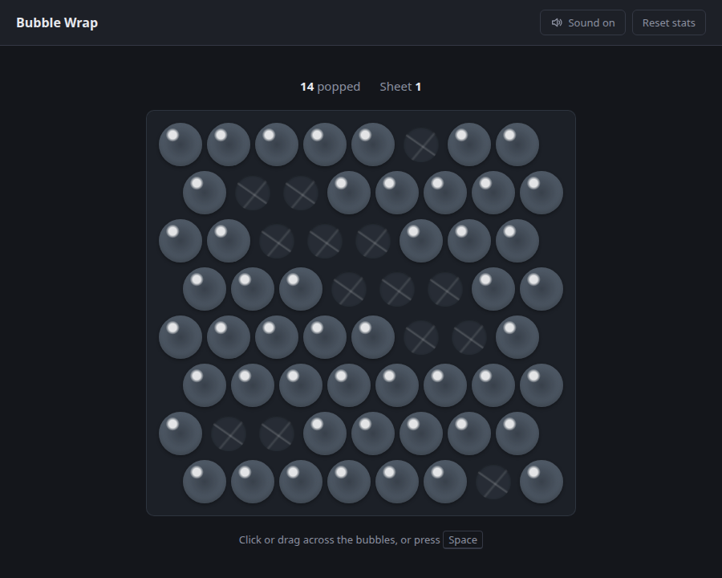

# Bubble Wrap

A sheet of bubble wrap for short breaks.

Pop every bubble and a new sheet slides in. There is no score to beat and nothing
to finish, so you can close the tab at any moment.



## How to play

- Click or tap a bubble to pop it.
- With a mouse, hold the left button and drag across the bubbles.
- Press <kbd>Space</kbd> to pop a random one. Holding it down only counts once.
- **Reset stats** puts the popped count and the sheet number back to the start.

Nothing is saved yet: reloading the page starts over, sound setting included.

## Development

Requires Node 24.

```sh
npm install
npm run dev      # dev server on http://localhost:5173
npm run check    # lint, type check and tests
npm run build    # static site in dist/
```

To try it on a phone, run `npm run dev -- --host` and open the Network URL from
a device on the same network.

| File | What's in it |
|---|---|
| `src/game.ts` | The rules: popping, finishing a sheet, picking a random bubble. No DOM, unit-tested. |
| `src/drag.ts` | The points a drag passes through. Unit-tested. |
| `src/main.ts` | DOM and input. |
| `src/sound.ts` | Loads the pops and plays them. |
| `public/pops/` | Eight short pops, picked at random and varied slightly in pitch and volume. |

A fast drag only reports a position every few dozen pixels, so the stretch between
two reports is walked as a straight line. Otherwise a quick swipe would jump over
bubbles.

## Docker

```sh
docker build -t bubble-wrap .
docker run --rm --read-only --tmpfs /tmp -p 8080:8080 bubble-wrap
```

Every `vX.Y.Z` tag publishes `ghcr.io/ophusdev/bubble-wrap` for `linux/amd64`
and `linux/arm64`. The container:

- serves plain HTTP on port 8080 as a non-root user, so TLS belongs in front of it;
- needs no environment variables, volumes or secrets;
- runs with a read-only root filesystem, given a writable `/tmp`;
- answers `GET /healthz` with `204`;
- sends a strict Content Security Policy and caches hashed assets for a year.

## Releasing

```sh
npm version minor -m "chore(release): %s"   # bumps package.json, commits, tags vX.Y.Z
git push --follow-tags
```

## Sounds

The pops in `public/pops/` are cut from
[Bubble Wrap Pop](https://pixabay.com/sound-effects/film-special-effects-bubble-wrap-pop-87928/)
by thedapperdan via Pixabay, under the
[Pixabay Content License](https://pixabay.com/service/license-summary/). They are
here as part of the game and aren't licensed for redistribution on their own.

## License

The code is [MIT](LICENSE). The sounds are not, see above.
